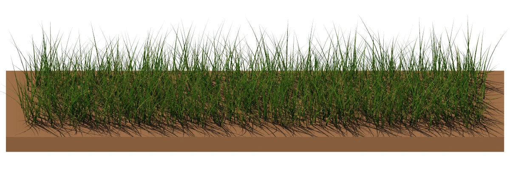
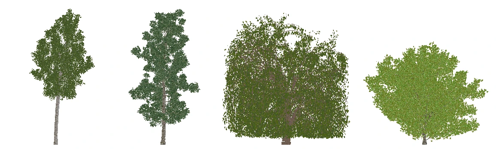
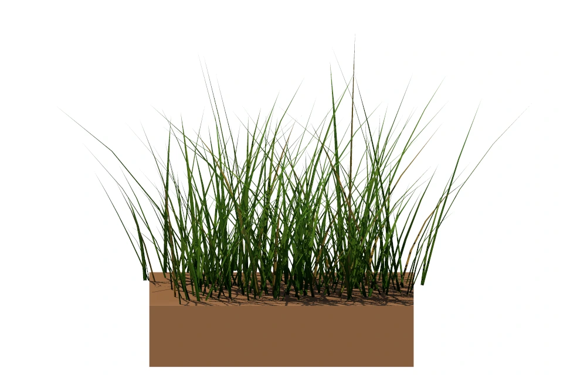
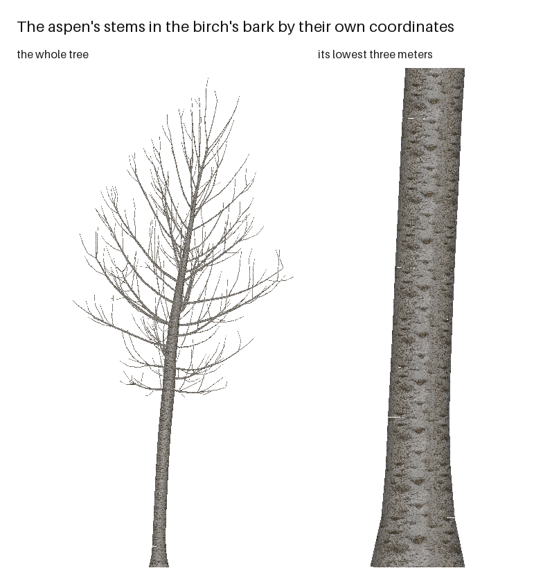
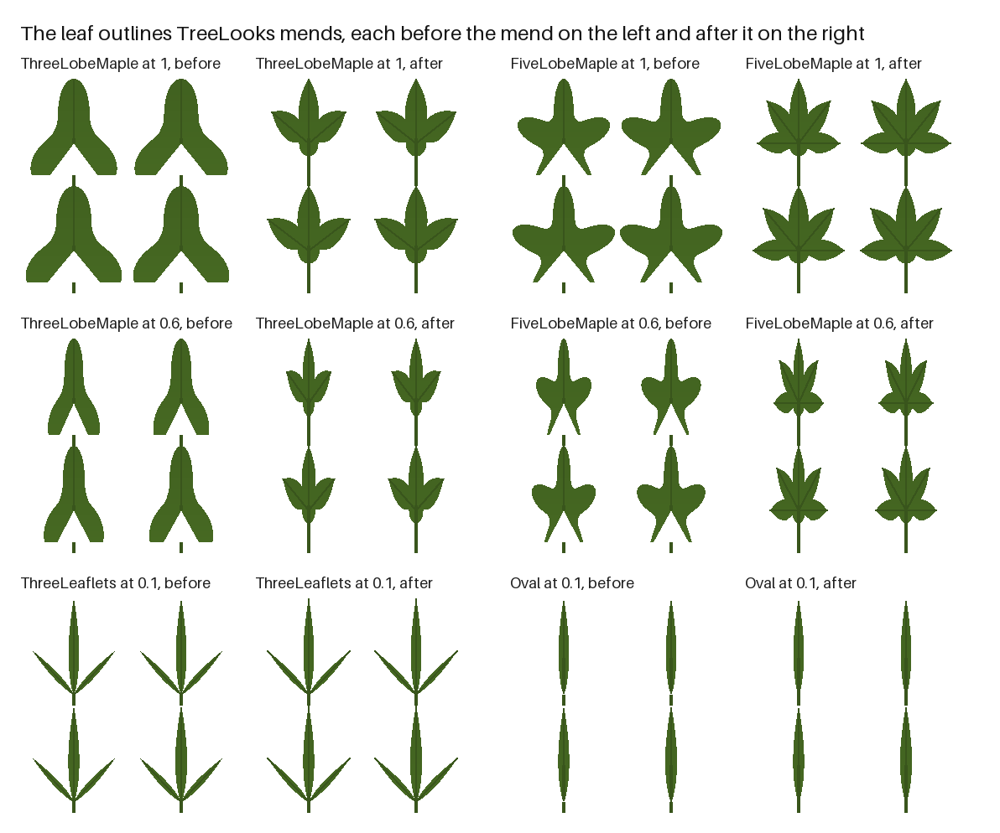
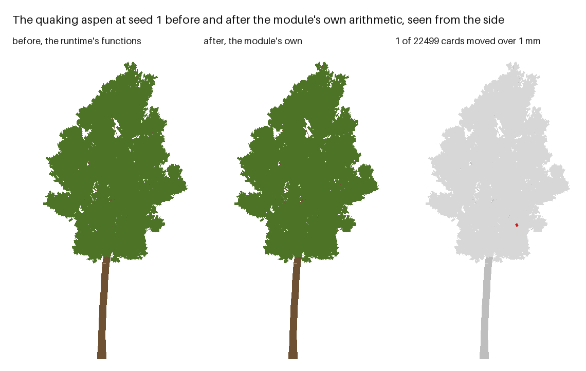
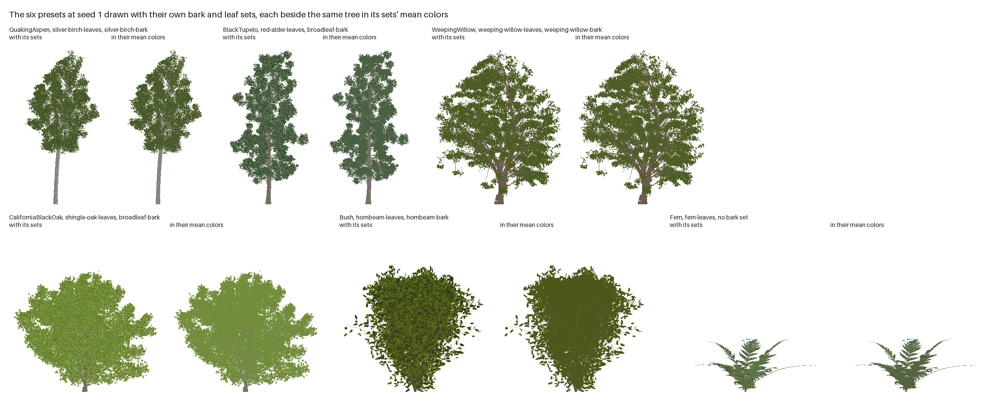
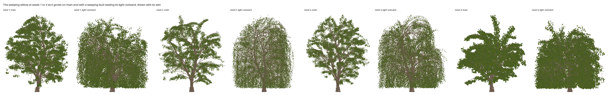

# Vegetation devlog

What landed in Vegetation, by day and newest first, with the pictures taken on the way, the captures
the repository keeps under `.github/assets` and the pictures made while an item was built, kept
under `.github/assets/readings` as WebP files named by their day, each on the day its name says, and
the notes written beside them as Markdown files named the same way. A line under Done names the item
of .github/REVIEW.md or .github/REVIEW-ARCHIVE.md and the commit that closed it.

## 2026-11-22

The default lawn, autumn, healthy and thick, in a patch 2.4 meters by 0.6 at 800 clumps a square
meter, a closed mat of fine blades under limp coarse tufts that cross, a few blades dry, in a high
sun and a sky, seen from a little above with no soil showing.

The quaking aspen, the black tupelo, the weeping willow and the California black oak at seed 1, each
grown from its preset and drawn with its own bark and leaf textures from the carried KTX2 files.

A patch of the default lawn 0.35 meters by 0.25 seen from near the ground, where single blades,
their light through them and their shadow on one another show, the coarse ones bending over the fine
mat.

Commits that day

- `a130429` The README's two grass captures are retaken from the default lawn, one wide and one
  close, since they showed the upright meadow the module no longer plants by default.
- `7487466` The grass is now a lawn of two layers, a closed mat of fine blades under limp coarse
  tufts that cross, set by a kind, a season, a health and a thickness that a host blends, so it
  matches the photographs of a real lawn and the upright meadow stays as a preset.
- `18bcf64` The grass grows as photographed blades, five to nine to a clump with three to eight
  millimeters at the root, tinted by the settings and mixed with dry ones, standing 350 clumps a
  square meter, and the README shows the patch and a close one in sun and shadow.
- `ef81919` The program that draws the README's two captures is kept in a scripts folder and takes
  the folder to write them into, so a capture can be retaken when what it shows changes.
- `81f316b` The README's two captures are retaken with each pixel the average of sixteen samples and
  the grass stands on soil.
- `8f8f082` The README shows four preset trees and a patch of grass under its title.

## 2026-11-21

Commits that day

- `8b24587` The texture collection's manifest is read by the Materials module's TextureCollection,
  taken as a submodule pinned at its head, in place of the reader the module wrote for it.
- `9943234` Tools is pinned at be1b6ab, and the rules name the Tools module's gpu.py as the one gate
  for the GPU lock.

## 2026-11-20

Commits that day

- `f60a577` The module's repository and the Tools submodule are named by their new addresses,
  3DEngine.Vegetation and 3DEngine.Tools, in the README's link row and the submodule's.

## 2026-11-19

The quaking aspen's stems at seed 1 drawn with the silver birch's bark by their own count round and
coordinate along, the whole tree beside its lowest three meters, lit as round, the bark's marks
keeping their shape up the tapering trunk.

Commits that day

- `d478a7e` The library gives each stem as a tube needs it, its points, its radii and its bark
  wrapped round and along it so the bark keeps its shape the length of a tapering stem, and the
  binding builds its tubes from them.
- `ffcb8c1` The texture collection is made by the Materials module's script in place of the module's
  own, every albedo encoded closer to its source, and the mean color's test reads the BC7 modes it
  writes.

## 2026-11-18

The bark's color, normal and depth and an atlas of each of the six leaf shapes at a width of 0.6, as
TreeLooks makes them, the leaves tinted by a species' default leaf color on a white ground.

The two maples at widths 1 and 0.6 and the three leaflets and the oval at 0.1, each before the mend
on the left and after it on the right, the maples' lobes pointed and veined over a small base that
meets the stalk and every leaf one piece from its stalk to its tips.

The quaking aspen at seed 1 grown with the runtime's functions beside the same seed grown with the
module's own arithmetic, which every system grows alike, and in red the one of its 22,499 cards that
moved more than a millimeter, by 9.8 cm; its stems moved by a micrometer at most.

The six presets at seed 1 drawn with their own bark and leaf sets from the carried KTX2 files, the
leaves sampled by their own texture coordinates and cut by alpha, each beside the same tree in its
sets' mean colors, as bright as the sets they stand for; the bark is mapped round its stems by a
stand-in, since the module holds no stem mesh, and the fern, which names no bark set, takes its bark
color.

The six presets at seed 1 before and after the leaves are shared by a twig's length, drawn with
their sets, the weeping willow large beside them; a long twig is leafed along its length, and the
willow's long hanging stems, which carry their few twigs near their ends, stand as bare as before.

The weeping willow at seeds 1 to 4 large, as it grew before beside its buds reading their light
outward from the trunk, drawn with its sets, its curtain hanging from the crown to near the ground
where it stood round.

Commits that day

- `87aee13` A weeping species' buds read their light outward from the trunk, so the willow's hanging
  stems leaf down their length and its crown hangs as a curtain where it stood round.
- `c096761` A twig takes its share of the leaves by its length, so a long one is leafed along it as
  a typical one is, the total held at the count, and the weeping willow is held to the fall of its
  stems and the hang of its rim's leaves.
- `86df852` The tests take the checks every module keeps from the Tools submodule in place of their
  own copies, the cheatsheet lists every public type and member as the built library writes it, and
  no text of the module names an engine.
- `aabe6c6` The devlog shows the six presets drawn with their own carried bark and leaf sets beside
  their mean colors, the leaves taking their sets by their own texture coordinates.
- `cb2ab62` A texture set's mean color is the linear mean of its albedo's opaque texels as it is
  said to be, where it was the mean in sRGB decoded and darker by up to 0.045 for a grass card.
- `caa688f` Git leaves out every __pycache__ folder, the bytecode Python writes beside a script it
  runs, so running the texture recipe adds nothing to the tree.
- `3bb3fc2` The texture files are plain KTX2, every level's blocks as a GPU samples them with no
  supercompression, so a reader with no decompressor uploads them in place, the collection made
  again to the same blocks.
- `6eb2449` A seed grows the same tree to the bit on every system, the growth, the leaves and the
  pictures taking the module's own sine, cosine, power, exponential and arc functions and products
  written out a term at a time, held to a fixture of the module's trees.
- `ebde5e3` A test hashes the runtime's sine, cosine, power, exponential and vector products and
  each preset's growth against the machine that wrote its probes, so a run on another system names
  the first number that parts.
- `7f4f355` A test fails where a public name or the documentation of the library names either
  engine, which the README names as two bindings alone.
- `6b7d7c5` A test fails where the library references an engine, a window or a graphics API, read
  from its assembly's references and the packages its build resolves.
- `129f23d` The README's binding runs in the tests against a host that stands in for an engine, a
  test holds the README's code the same as the code run, and a lone leaf's way out has a test of its
  own.
- `fa391b2` The README says how to bind the module in any engine, the conventions it stands on and
  the smallest binding that plants a forest and a field of grass, and the turns of a tree and a
  clump say their direction.
- `c75c8e8` The library builds as the assembly and package 3DEngine.Vegetation and its tests as
  3DEngine.Vegetation.Tests, the namespace staying Vegetation.
- `831a464` Every generated leaf is one piece from its stalk to its tips, the maples drawn as
  pointed and veined lobes over a small base that meets the stalk, and the build script's docstrings
  hold to 100 columns by the same test as the comments.

## 2026-11-17

Commits that day

- `f3ad69c` The ignore file's note on the pictures folder names no one, and the guides spell
  canceled.

## 2026-11-09

Done that day

- Item 6 at `f18a993`. The texture sets.
- Item 7 at `d604e4d`. The grass's scatter.
- Item 8 at `2fba808`. The planting's placement.

Commits that day

- `f18a993` The texture sets move here with their recipe, carried in the module's assembly and
  opened by their paths.

## 2026-11-08

Done that day

- Item 5 at `c2149be`. The species and the skeleton.

## 2026-10-31

Done that day

- Item 1 at `41b4925`. The documents, one commit.
- Item 2 at `63fc628`. The skeleton, one commit after item 1.

Commits that day

- `63fc628` The module gains its solution, an empty library whose public members need summaries, a
  test that it loads, the version at 0.1 and a build workflow on Linux, Windows and macOS.
- `41b4925` The module gains its documents, AGENTS.md, the README, STYLE.md, COMMITS.md and the code
  of conduct as the engines keep them, with git's ignore and attribute files.
