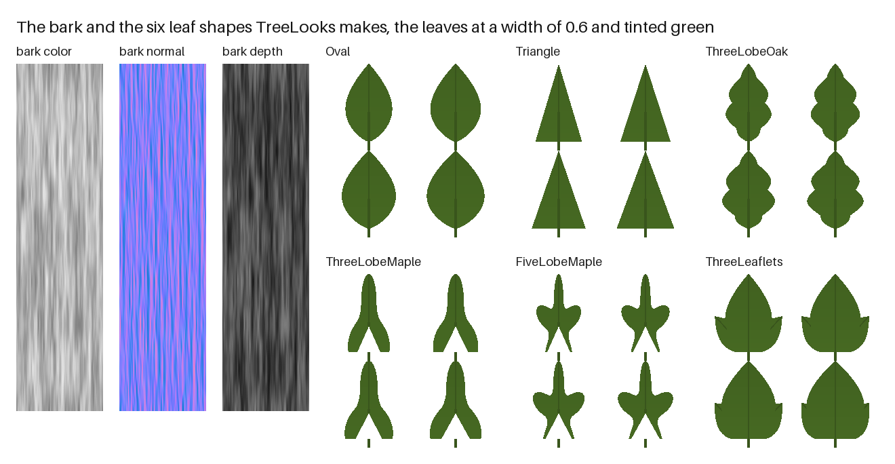
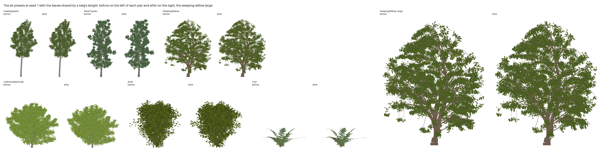

# Vegetation devlog

What landed in Vegetation, by day and newest first, with the pictures taken on the way, the captures
the repository keeps under `.github/assets` and the pictures made while an item was built, kept
under `.github/assets/readings` as WebP files named by their day, each on the day its name says, and
the notes written beside them as Markdown files named the same way. A line under Done names the item
of .github/REVIEW.md or .github/REVIEW-ARCHIVE.md and the commit that closed it.

## 2026-11-18

The bark's color, normal and depth and an atlas of each of the six leaf shapes at a width of 0.6, as
TreeLooks makes them, the leaves tinted by a species' default leaf color on a white ground.

The two maples at widths 1 and 0.6 and the three leaflets and the oval at 0.1, each before the mend
on the left and after it on the right, the maples' lobes pointed and veined over a small base that
meets the stalk and every leaf one piece from its stalk to its tips.

The quaking aspen at seed 1 grown with the runtime's functions beside the same seed grown with the
module's own arithmetic, which every system grows alike, and in red the one of its 22,499 cards that
moved more than a millimeter, by 9.8 cm; its stems moved by a micrometer at most.

The six presets at seed 1 drawn with their own bark and leaf sets from the carried KTX2 files, the
leaves sampled by their own texture coordinates and cut by alpha, each beside the same tree in its
sets' mean colors, as bright as the sets they stand for; the bark is mapped round its stems by a
stand-in, since the module holds no stem mesh, and the fern, which names no bark set, takes its bark
color.

The six presets at seed 1 before and after the leaves are shared by a twig's length, drawn with
their sets, the weeping willow large beside them; a long twig is leafed along its length, and the
willow's long hanging stems, which carry their few twigs near their ends, stand as bare as before.

## 2026-11-09

Done that day

- Item 6 at `f18a993`. The texture sets.
- Item 7 at `d604e4d`. The grass's scatter.
- Item 8 at `2fba808`. The planting's placement.

## 2026-11-08

Done that day

- Item 5 at `c2149be`. The species and the skeleton.

## 2026-10-31

Done that day

- Item 1 at `41b4925`. The documents, one commit.
- Item 2 at `63fc628`. The skeleton, one commit after item 1.
